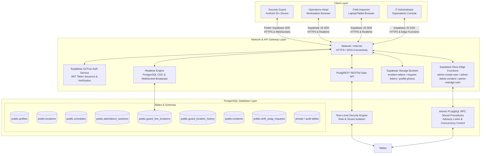
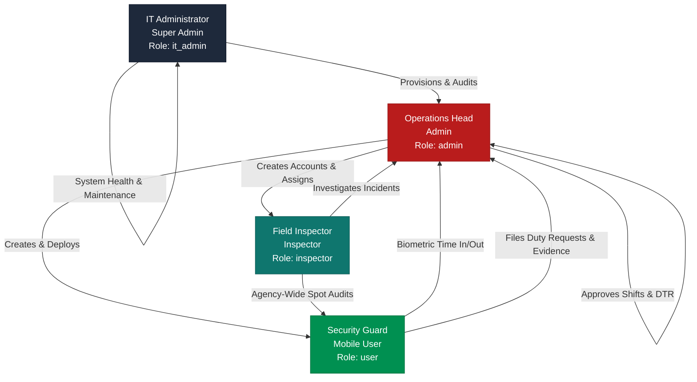
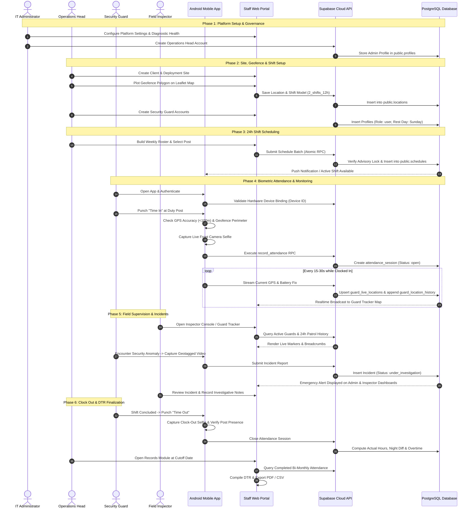
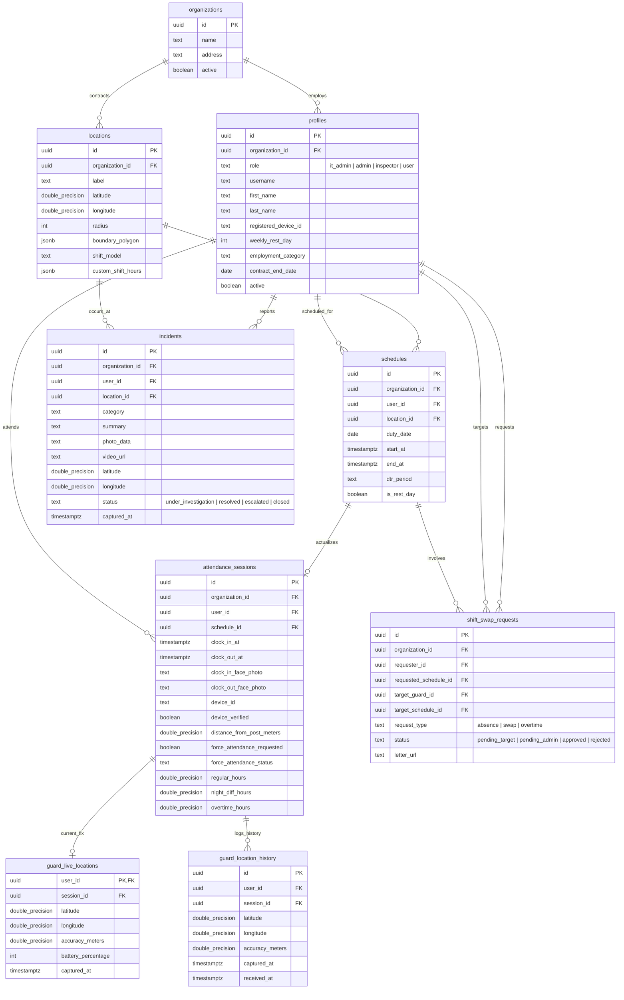
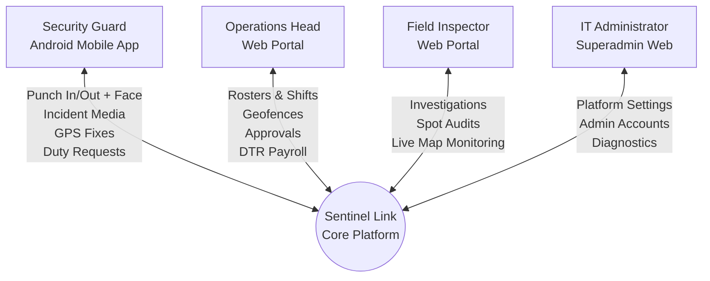
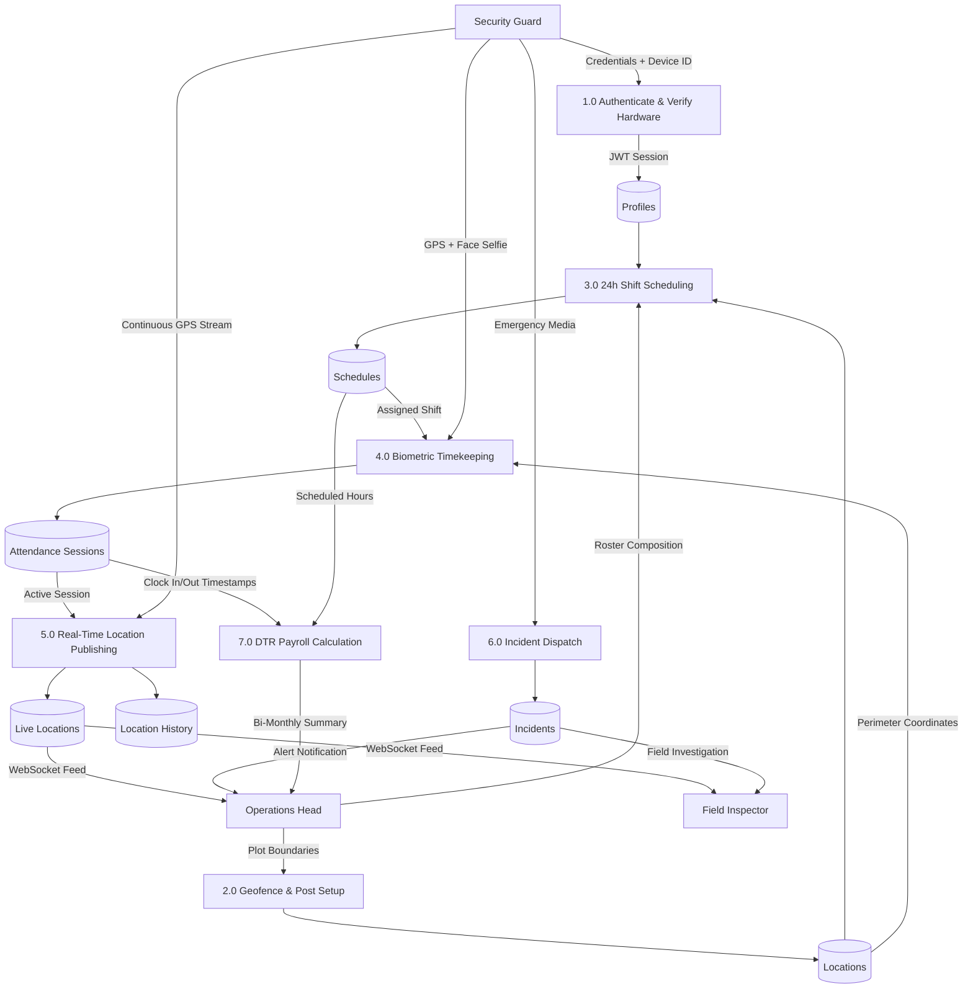
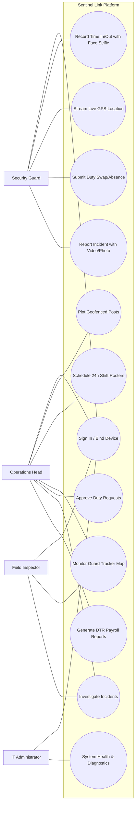

# Sentinel Link: Complete System Flow & Architectural Documentation
**Security Agency Management System with Mobile Application for Real-Time Monitoring**
*Beneficiary Organization: Twenty Twenty Security Agency, Inc.*  
*Date of Audit & System Analysis: November 2026*  
*Document Version: 2.1 (Production Implementation Alignment)*

---

## 1. System Overview

### 1.1 Purpose & Scope
**Sentinel Link** is an integrated workforce management, automated biometric timekeeping, GPS geofenced deployment, and real-time field supervision platform custom-engineered for **Twenty Twenty Security Agency, Inc.** (headquartered in Bacolod City, Negros Occidental). The platform bridges two complementary client interfaces:
1. **Administrative Web Management Portal:** Built with HTML5, CSS3, vanilla JavaScript (ES6+), Bootstrap 5, Leaflet.js mapping, and Supabase client SDKs, providing role-based command consoles for **IT Administrators (Super Admin)**, **Operations Heads (Admin)**, and **Field Inspectors**.
2. **Guard Mobile Application:** Built with Flutter 3.x and Dart 3.x, deployed to physical **Android devices** for deployed security guards in the field.

### 1.2 Core Architectural Principles
* **Single Source of Truth:** A cloud-native PostgreSQL 15 database hosted on Supabase manages all transactional state, personnel records, schedules, and spatial geometries.
* **Hardware-Bound Identity:** Guards are authenticated using email/password credentials or username aliases tied to a cryptographic/persistent device fingerprint (`registered_device_id`).
* **Multi-Factor Attendance Verification:** Timekeeping records require simultaneous satisfaction of three criteria:
  1. *Temporal:* Validated against an active scheduled duty shift.
  2. *Spatial:* Physical presence confirmed within a polygonal or circular geofence boundary (accuracy < 100m).
  3. *Biometric:* Live in-app front camera face capture captured at clock-in and clock-out.
* **Row-Level Security (RLS) & Atomic RPCs:** Client applications never perform raw, unconstrained writes. All sensitive operations (attendance recording, shift swapping, schedule formulation, and location publishing) execute through PostgreSQL stored procedures (`SECURITY DEFINER` RPCs) protected by session-level advisory locks to eliminate race conditions.

---

## 2. System Architecture



### 2.1 Communication Protocols & Mechanics
* **Mobile to Backend:** Uses the official `supabase_flutter` package. Authenticated REST calls communicate over HTTPS via TLS 1.3. Live GPS location stream broadcasts directly to PostgreSQL through atomic RPCs (`update_guard_location`).
* **Web to Backend:** Operates via `@supabase/supabase-js` v2.112.3. A legacy facade (`supabase-firebase-bridge.js`) intercepts legacy `firebase.auth()` and `db.collection()` calls, translating them into asynchronous PostgREST queries and RPC invocations.
* **Server to Clients (Realtime):** Supabase Realtime listens to PostgreSQL Write-Ahead Logs (WAL) via triggers (`private.signal_guard_location_change`) and broadcasts events over WebSockets to topic channels (e.g., `live-guards:<viewerId>`).

---

## 3. User Roles and Permissions



### Role Permission Matrix

| Module / Capability | IT Admin (`it_admin`) | Operations Head (`admin`) | Field Inspector (`inspector`) | Security Guard (`user`) |
| :--- | :---: | :---: | :---: | :---: |
| **Login Portal** | `web/system-access-7d92a4/` | `web/staff/login.html` | `web/staff/login.html` | Flutter Android App |
| **System Diagnostics & Telemetry** | Full Access | No Access | No Access | No Access |
| **Admin & Ops Head Account Creation** | Full Access | No Access | No Access | No Access |
| **Guard & Inspector Account Management** | Read-Only | Full CRUD & Reset | View Profile & Contact | View Own Profile |
| **Hardware Device ID Reset** | Full Control | Full Control | No Access | Automatic Binding |
| **Client Site & Geofence Setup** | Read-Only | Full CRUD & Drawing | View Sites & Geofences | View Assigned Site |
| **24h Shift Rostering & Time Edits** | No Access | Full CRUD & Locking | View Roster | View Own Shifts |
| **Duty Request Approval (Absence/Swap)** | No Access | Full Approval Authority | View Requests | Create & Cancel Own |
| **Geofenced Biometric Attendance** | No Access | Force-Attendance Approval | Audit Attendance Logs | Clock-In / Out + Face |
| **Live Guard Tracker (Real-Time GPS)** | No Access | Agency-Wide Live Map | Agency-Wide Live Map | Broadcast Own GPS |
| **24h Breadcrumb History Playback** | No Access | Full History Access | Full History Access | No Access |
| **Incident Investigation & Status** | Purge / Admin Delete | Full Management & Disposition | Full Investigation Notes | File Incident + Media |
| **Daily Time Record (DTR) & PDF Export** | No Access | Full Master Payroll Export | View & Audit Logs | View & Export Own PDF |

---

## 4. Module Descriptions (All 14 Core Modules)

### 4.1 Authentication and User Management
* **Implementation:** `lib/login.dart`, `web/staff/login.html`, `web/system-access-7d92a4/login.html`, `supabase/functions/admin-create-user`.
* **Mechanics:** Authenticates via Supabase Auth. Mobile app validates hardware device binding. On first sign-in, the guard's device fingerprint (`UUID` + hardware specs) is registered into `public.profiles.registered_device_id`. Subsequent sign-ins on unrecognized devices trigger an error requiring administrator device unlock.

### 4.2 Personnel Management
* **Implementation:** `web/admin/users.html`, `web/it-admin/users.html`, `lib/guard_profile.dart`.
* **Mechanics:** Operations Head manages guard profiles, employee IDs, blood types, license credentials (security guard license expiry), employment category (Regular, Probationary, Fixed-Term Contract with automated expiration warnings), and emergency contacts. Supports avatar image compression and upload via RPC.

### 4.3 Client and Security Post Management
* **Implementation:** `web/admin/locations.html`, `web/inspector/locations.html`.
* **Mechanics:** Formulates client records (e.g., educational campuses, commercial offices, industrial sites). Stores detachment names, addresses, primary contact persons, phone numbers, and contract periods.

### 4.4 Geofence Configuration
* **Implementation:** `web/admin/locations.html`, `web/js/ph-location-search.js`.
* **Mechanics:** Integrates OpenStreetMap and Leaflet.js. Operations Head sets geofence circle radius (default 50m–100m, min 25m, max 1000m) or plots custom multi-point polygonal geofence boundaries stored as GeoJSON in `public.locations.boundary_polygon`.

### 4.5 Personnel Deployment and Scheduling
* **Implementation:** `web/admin/schedule.html`, `web/admin/js/shift-roster.js`.
* **Mechanics:** Generates 24-hour guard shift rosters using site-contracted shifting models:
  * `2_shifts_12h`: Day (06:00–18:00) / Night (18:00–06:00).
  * `3_shifts_8h`: Shift 1 (06:00–14:00), Shift 2 (14:00–22:00), Shift 3 (22:00–06:00).
  * `custom`: Variable start/end times with interactive time picker.
* **Concurrency Locking:** Employs PostgreSQL advisory locks (`pg_try_advisory_xact_lock`) during batch schedule insertions to prevent overlapping shift conflicts.

### 4.6 Rest Day Management
* **Implementation:** `web/admin/schedule.html`, `public.profiles.weekly_rest_day`.
* **Mechanics:** Guards are assigned a designated weekly rest day (0 = Sunday to 6 = Saturday). During roster compilation, the scheduler automatically detects the guard's designated rest day, preventing unintentional shift assignment unless an explicit relief or overtime duty is designated.

### 4.7 Duty Requests (Leave and Shift Swap)
* **Implementation:** `lib/letter_request.dart`, `web/admin/swaps.html`, `web/admin/js/duty-requests.js`.
* **Mechanics:** Guards file three request types:
  1. *Absence (Leave):* Medical/personal leave with optional attached letter document.
  2. *Shift Swap:* Selects an assigned shift and a target guard with a target shift. Requires two-tier consent: peer guard accepts first, then Operations Head approves.
  3. *Overtime:* Shift extension request.
* **Execution:** Approving a swap triggers an atomic RPC that exchanges `user_id` values on the corresponding `schedules` rows.

### 4.8 Geofence-Based Attendance (Time In and Time Out)
* **Implementation:** `lib/attendance.dart`, `lib/services/attendance_service.dart`.
* **Mechanics:** Guards can time in within a pre-shift buffer window (typically 30–60 minutes prior to shift start). Time In requires:
  * GPS accuracy < 100 meters.
  * Spatial verification inside the site's geofence radius or polygon.
  * Live camera selfie capture watermarked with timestamp and coordinates.
  * Time Out similarly requires post-shift presence verification and a mandatory clock-out selfie.
* **Force Attendance:** If GPS drift or an emergency prevents on-site attendance, the guard can submit a Force Attendance request with a mandatory explanation, pending Operations Head review.

### 4.9 Real-Time Guard Location and Status Monitoring (Guard Tracker)
* **Implementation:** `lib/widgets/duty_tracking_scope.dart`, `web/admin/live-tracking.html`, `web/js/live-tracking.js`.
* **Mechanics:** Active duty guards stream their GPS fixes every 10–30 seconds to `public.guard_live_locations`. Web consoles stream real-time marker animations:
  * *Green ring:* Active, updated within 2 minutes.
  * *Amber ring:* Idle/waiting, 2 to 5 minutes old.
  * *Gray ring:* Lost signal (> 5 minutes).
* **24h Patrol History:** Every location update is persisted in `public.guard_location_history`, allowing administrators to play back historical patrol trails on Leaflet maps.

### 4.10 Incident Reporting with Photo and Video Evidence
* **Implementation:** `lib/incident_report.dart`, `web/admin/incidents.html`, `web/inspector/incidents.html`.
* **Mechanics:** On-duty guards capture in-app photos or video clips (up to 15 seconds) with GPS watermarking. Categories include: Emergency, Theft, Property Damage, Trespassing, Medical Emergency, Disorderly Conduct, Fire Hazard, and Equipment Failure. Stored in `public.incidents` with status tracking (`under_investigation`, `resolved`, `escalated`, `closed`).

### 4.11 Emergency Alert
* **Implementation:** `lib/homepage.dart:375`, `lib/incident_report.dart`.
* **Mechanics:** Mobile homepage features an instant red **Emergency Alert** button. Tapping immediately launches high-priority incident reporting, triggers audible system alerts, and flags the incident table on web consoles with immediate emergency banners.

### 4.12 Daily Time Record (DTR) Management
* **Implementation:** `web/js/dtr-report.js`, `lib/models/guard_dtr.dart`, `lib/services/guard_dtr_pdf.dart`.
* **Mechanics:** Evaluates attendance against Philippine labor standards across semi-monthly cutoffs (1st–15th and 16th–end of month). Automatically splits hours into:
  * *Regular Hours:* Up to 8 or 12 scheduled hours.
  * *Night Shift Differential:* Hours worked between 10:00 PM and 06:00 AM.
  * *Overtime Hours:* Approved extension past scheduled shift.
* **Export:** One-click generation of agency-formatted printable PDF DTRs and CSV export.

### 4.13 Overtime Management
* **Implementation:** `lib/widgets/overtime_timeout_dialog.dart`, `web/admin/swaps.html`.
* **Mechanics:** When clocking out beyond shift end time, guards are prompted to choose between Normal Timeout or Filing Overtime. Overtime requests are routed to Operations Head for authorization before being factored into payroll DTR hours.

### 4.14 Reports and Record Management
* **Implementation:** `web/admin/records.html`, `web/admin/dashboard.html`.
* **Mechanics:** Provides historical archives of all shifts, completed DTRs, resolved incidents, guard contracts, and platform audit trails.

---

## 5. Complete System Workflow



---

## 6. Individual Role Workflows

### 6.1 Super Admin / IT Administrator (`it_admin`)
1. **Authentication:** Accesses dedicated administrative login at `web/system-access-7d92a4/login.html`.
2. **Dashboard Overview:** Views real-time counts of active accounts, Superadmins, Operations Heads, and active field guards.
3. **Platform Controls:** Runs diagnostic system checks, toggles system maintenance mode, configures password complexity rules, and inspects backend error telemetry.
4. **Credential Governance:** Creates and recovers Operations Head credentials, manages Superadmin privileges, and overrides locked hardware device bindings.

### 6.2 Operations Head (`admin`)
1. **Authentication:** Logs in via `web/staff/login.html`.
2. **Personnel Administration:** Enrolls guards and inspectors, defines employment contracts (Regular, Probationary, Contract with end dates), and sets weekly rest days.
3. **Client Posts & Geofencing:** Establishes client organizations, detachment posts, geofence radius/polygons, and contract shift models.
4. **Duty Scheduling:** Formulates daily and weekly 24-hour shift rosters with interactive shift time adjustments.
5. **Request Adjudication:** Reviews and approves/rejects Absence, Shift Swap, and Overtime requests.
6. **Live Operations Supervision:** Monitors active guards via the **Guard Tracker**, monitors battery/accuracy status, and inspects 24-hour patrol history breadcrumbs.
7. **Payroll Reporting:** Generates and audits semi-monthly DTR reports, verifies night differential and overtime computations, and exports master PDFs/CSVs.

### 6.3 Field Inspector (`inspector`)
1. **Authentication:** Logs in via `web/staff/login.html` (automatically routed to Inspector Console).
2. **Agency-Wide Oversight:** Reviews all active guards, deployment sites, and active guard rosters across the entire agency.
3. **Field Audits & Spot Inspections:** Navigates the **Guard Tracker** live map to verify guard presence at client posts.
4. **Active Field Investigations Queue:** Follows up on incident reports submitted by guards, uploads field inspection notes, and updates incident resolution status (`under_investigation`, `resolved`, `escalated`, `closed`).
5. **Attendance Verification:** Inspects guard attendance logs and time records to ensure post integrity.

### 6.4 Security Guard (`user`)
1. **Authentication & Hardware Binding:** Signs in using the Android Mobile App; device fingerprint is registered.
2. **Roster Inspection:** Views approved duty schedules, assigned client posts, and shift start/end times.
3. **Biometric & Geofenced Clock-In:** Arrives at post, initiates Time In, validates GPS within geofence, and captures mandatory selfie.
4. **Active Shift Tracking:** Device automatically streams periodic GPS coordinates while clocked in.
5. **Incident Filing:** Dispatches emergency reports with photos or 15-second video clips.
6. **Duty Requests:** Files requests for planned absence, peer shift swap (with attached letters), or post-shift accomplishment reports.
7. **Clock-Out & DTR Review:** Punches Time Out with concluding selfie; inspects personal DTR summary and downloads printable PDF DTRs directly on mobile.

---

## 7. Module-to-Module Connections

```mermaid
flowchart TD
    M3[3. Client & Post Management] -->|Defines Coordinates| M4[4. Geofence Configuration]
    M2[2. Personnel Management] -->|Provides Active Guards & Rest Days| M5[5. Personnel Deployment & Scheduling]
    M4 -->|Assigns Site Geofence| M5
    M6[6. Rest Day Management] -->|Restricts Shift Days| M5
    
    M5 -->|Approved Shifts| M7[7. Duty Requests (Swap/Absence)]
    M7 -->|Approved Swaps Exchange user_id| M5
    
    M5 -->|Establishes Attendance Window| M8[8. Geofenced Biometric Attendance]
    M4 -->|Validates Time In/Out Boundary| M8
    
    M8 -->|Active Session Triggers Location Stream| M9[9. Real-Time Guard Tracker]
    M8 -->|Shift Extension Triggers| M13[13. Overtime Management]
    M13 -->|Approved Overtime Factors into| M12[12. DTR Management]
    
    M8 -->|Clock In/Out Timestamps| M12
    M5 -->|Scheduled Shift Baseline| M12
    
    M8 -->|Active Duty Requirement| M10[10. Incident Reporting]
    M10 -->|High-Priority Alarm| M11[11. Emergency Alert]
    
    M12 -->|Bi-Monthly Cutoff Aggregation| M14[14. Reports & Record Management]
    M10 -->|Archived Incident Dispositions| M14
```

---

## 8. Database Structure and Relationships



---

## 9. System Flowcharts and Diagrams

### 9.1 Data Flow Diagram (DFD Level 0 - Context Diagram)


### 9.2 Data Flow Diagram (DFD Level 1)


### 9.3 Use Case Diagram


---

## 10. Identified Issues and Recommendations

1. **Base64 Photo Storage Bloat:**
   * *Finding:* Incident photos and attendance face selfies (`clock_in_face_photo`, `clock_out_face_photo`, `incidents.photo_data`) are stored as raw Base64 strings directly in PostgreSQL table rows.
   * *Impact:* High database bloat over time as thousands of shifts accumulate.
   * *Recommendation:* Transition photos to a Supabase Storage bucket (`attendance-selfies`), storing only relative object keys in the database.
2. **Hardcoded Supabase Project URL in Frontend Scripts:**
   * *Finding:* `lib/supabase_config.dart` and `web/js/supabase-firebase-bridge.js` contain hardcoded domain strings (`https://syyofdcynuzgergqlaqj.supabase.co`).
   * *Recommendation:* Inject URLs via runtime environment variables (`dotenv` or Flutter compile-time define `--dart-define`) for clean environment portability.
3. **Hardware Device ID Volatility:**
   * *Finding:* Mobile app device ID relies on `SharedPreferences` generated via `Random().nextInt(0xFFFFFF)`. Clearing app data or cache generates a new ID, locking the guard out until Operations Head resets their device binding.
   * *Recommendation:* Use native hardware identifiers via `device_info_plus` with secure hardware keystore storage (`flutter_secure_storage`).
4. **Mobile Device Clock Drift Sensitivity:**
   * *Finding:* Migration `20260914000001_incident_photo_or_video.sql` enforces `p_captured_at <= v_now + interval '1 minute'`. If the guard's phone clock is fast by >60 seconds, incident submissions fail.
   * *Recommendation:* Relax server clock boundary to 5 minutes or synchronize time with the server via an RPC ping prior to filing.
5. **Flutter Package Name Legacy Placeholder:**
   * *Finding:* `pubspec.yaml` retains default name `flutter_application_1` instead of `sentinel_link`.
   * *Recommendation:* Refactor package identifier in `pubspec.yaml` to ensure clean, professional codebase imports.

---

## 11. Feature Implementation Status Matrix

| Module / Feature | Implementation Status | Verification Details |
| :--- | :---: | :--- |
| **Authentication & Role Segregation** | **Fully Implemented** | Supabase Auth gates routes across `it_admin`, `admin`, `inspector`, and `user`. |
| **Hardware Device ID Binding** | **Fully Implemented** | Automatic registration on first login; blocks secondary devices unless reset by Admin. |
| **Personnel Profiles & Contracts** | **Fully Implemented** | Extended fields, employment category, license expiry, and contract end dates. |
| **Client Site & Polygon Geofencing** | **Fully Implemented** | Leaflet.js polygon/circle drawing, Nominatim search, radius bounds (25m–1000m). |
| **24h Shift Rostering & Time Edits** | **Fully Implemented** | Supports 2-shift (12h), 3-shift (8h), and custom models with advisory locks. |
| **Weekly Rest Day Enforcement** | **Fully Implemented** | Detects assigned rest day (0–6) during roster building; blocks accidental booking. |
| **Duty Requests (Absence & Swaps)** | **Fully Implemented** | Absence/swap requests, reciprocal peer consent, attached letters, atomic RPC swaps. |
| **Geofenced Biometric Timekeeping** | **Fully Implemented** | Dual-point proximity check, GPS accuracy < 100m, and mandatory Time In/Out selfies. |
| **Force Attendance Workflow** | **Fully Implemented** | Exception filing with reason when outside geofence, subject to Operations Head review. |
| **Real-Time Guard Tracker** | **Fully Implemented** | WebSocket live location streaming with animated colored status rings on Leaflet map. |
| **24h Patrol History Playback** | **Fully Implemented** | Persisted in `guard_location_history`; interactive historical route playback. |
| **Geotagged Incident Reporting** | **Fully Implemented** | In-app camera, GPS watermark, video capture (up to 15s), status update queue. |
| **Emergency Alert Button** | **Fully Implemented** | Dedicated mobile homepage button launching high-priority emergency reporting. |
| **Semi-Monthly DTR Payroll Engine** | **Fully Implemented** | Bi-monthly cutoffs, regular hours, night differential (10PM–6AM), overtime, PDF/CSV export. |
| **Overtime Timeout Choice** | **Fully Implemented** | Guard prompted at clock-out if past shift end time to record overtime. |
| **Inspector Agency-Wide Oversight** | **Fully Implemented** | Full agency-wide inspection of guards, sites, rosters, and live GPS signals. |
| **Automated Financial Payroll / Banking** | **Excluded by Design** | Documented as out of scope; system calculates verified hours for payroll export. |
| **Photo Object Storage Migration** | **Partially Implemented** | Videos/letters use Storage buckets; photos currently stored as Base64 in database. |

